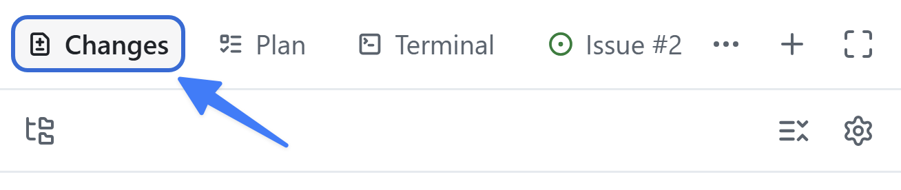

生成 AI を使う際はコンテキストが重要です。特定の方法でタスクを実行したい場合は、そのガイダンスを Copilot が利用できるようにします。[指示ファイル][instruction-files]には、求めるコードの内容だけでなく、その構成方法も記述します。フィルタリング機能を構築したので、Copilot が使用した指示を確認し、ドキュメント標準を追加して、コードに適用します。

このレッスンでは、次のことを行います。

- リポジトリの指示とパス指定の指示ファイルがエージェントに適用される仕組みを確認します。
- コーディング標準に従うよう、指示ファイルを更新します。
- 指示ファイルがコードに与える影響を確認します。

## シナリオ

Tailspin Toys では、開発プラクティスに関するガイドラインと要件を定めています。

- コメントには、コードの言い換えではなく、意図と自明でない判断を記載します。
- `db/` と `src/lib/` のエクスポートされた関数には、目的、パラメーター、戻り値 (該当する場合は注入可能な `db` 引数を含む) を説明する TSDoc/JSDoc を記載します。
- 再利用可能な Astro コンポーネントでは `Props` の契約を説明し、関連コードが変更された際にコメントも更新します。
- 既存の書式設定と lint のガイダンスを維持します。

指示ファイルを使い、Copilot がこれらのプラクティスに沿ってタスクを行えるようにします。

## 指示ファイル

カスタム指示を使うと、コーディングのスタイルや要件を Copilot に伝え、より適切な提案やコードを生成できるようにできます。推奨するコーディング規則、ライブラリ、コメントの書き方などを指定できます。リポジトリ全体、または特定のファイル種別に指示を設定できます。

指示ファイルには、次の 2 種類があります。

- `.github/copilot-instructions.md` は、リポジトリに対する**すべての**リクエストで Copilot に送信される単一の指示ファイルです。技術スタック、開発対象の概要、ベスト プラクティスなど、多くのチャットや CLI のリクエストで参照するプロジェクト レベルの情報を記載します。
- `.github/instructions/*.instructions.md` ファイルは、特定のタスクやファイル種別向けに作成できます。TypeScript や Astro などの言語、UI コンポーネントや単体テストの作成などのタスク向けにガイドラインを記載します。

> [!NOTE]
> ほかの指示形式やサポート状況は、使用するハーネスによって異なります。特定の形式に依存する前に、[カスタム指示のサポート リファレンス][custom-instructions-support]を確認してください。

## プロジェクトのカスタム指示ファイルを確認する

スターター プロジェクトには、すでに指示ファイルが含まれています。変更前に内容を確認して、指示の影響を把握しましょう。

1. 前のレッスンのセッションに戻ります。
2. レビュー パネルが表示されていない場合は、右上の **Toggle review panel** を選択して開きます。

   

3. **+** アイコンの **Open in panel** を選び、新しい Canvas を開きます。
4. **Files** を選択します。
5. **Gear** アイコンを選び、**Show hidden files** にチェックが付いていることを確認します。
6. `.github/copilot-instructions.md` に移動します。
7. ファイルを確認します。プロジェクトの説明のほか、**Agent notes**、**Code standards**、**Scripts**、**Repository Structure** などのセクションがあります。**Code standards** の下にある **GitHub Actions Workflows** のガイダンスを含め、Copilot とのあらゆるやりとりに適用されます。
8. `.github/instructions` フォルダーを開いて確認します。Astro ファイル、Drizzle データ レイヤー、テストなどの指示があります。
9. `.github/instructions/unit-tests.instructions.md` を開きます。先頭の `applyTo` フィールドは、リポジトリのルートからの glob で適用対象を指定します。たとえば、`**/*.test.ts` に一致する TypeScript のテスト ファイルに適用されます。
10. このプロジェクトで単体テストを作成するための指示を確認します。
11. 最後に `.github/instructions/drizzle.instructions.md` を開き、末尾までスクロールします。`unit-tests.instructions.md` などの指示ファイルや、プロジェクト内の既存ファイルへのリンクを確認します。これにより、指示を再利用しやすい小さなファイルに分け、Copilot が参照する例を示せます (パスは指示ファイルからの相対パスです)。

## チームのガイダンスに合わせて指示ファイルを更新する

既存のファイルはよい出発点ですが、追加したい標準があります。新たに生成される TypeScript に [TSDoc コメント][tsdoc]を記載するよう、中心となる `copilot-instructions.md` ファイルを変更します。

> [!NOTE]
> 指示ファイルは Copilot が生成するコードに大きな影響を与えるため、Copilot を明確にガイドする内容になっていることを確認してください。Copilot に初版の作成を依頼してから、自分で要件を満たすかレビューできます。[Awesome Copilot の指示ファイル集][awesome-copilot]を出発点として確認する方法もあります。

1. 同じ Files Canvas で `.github/copilot-instructions.md` に移動します。
2. ファイル ツールバーのコード ボタン (`<>` アイコン) を選択し、編集可能なソース ビューに切り替えます。
3. ファイルの中ほどにある **Code formatting requirements** 見出しを見つけます。
4. その見出しの下の最後の箇条書きに、次の内容を追加します。

   ```plaintext
   All new TypeScript should contain TSDocs comments for documentation purposes.
   ```

ファイルは自動的に保存され、使用できる状態になります。

## 更新したガイダンスを使う

指示ファイルを更新したので、更新内容をレビューして必要な変更を加えるよう Copilot に依頼し、生成コードへの影響を確認します。

> [!NOTE]
> 指示ファイルを変更した直後なので、ここでは使用するよう Copilot に明示的に伝えます。指示ファイルがすでに存在する状態でコードを生成する場合、明示しなくても Copilot が自動的に利用します。

1. 新しく追加した要件に合わせてコードを更新するよう、次のプロンプトを Copilot に送信します。

   ```plaintext
   We just updated our instructions and code guidance. Can you please update the code you generated to match that guidance?
   ```

2. 右上の **Changes** を選択してコードの変更を開きます。

   

3. TypeScript ファイルを確認します。新しく追加された TSDoc コメントを確認してください。

## まとめと次のステップ

アプリが指示ファイルからコンテキストを取得する仕組みを確認し、新しい標準を機能に適用しました。具体的には、次のことを行いました。

- リポジトリの `copilot-instructions.md` とパス指定の `*.instructions.md` ファイルを確認しました。
- コーディング標準に従うよう、指示ファイルを更新しました。
- 指示ファイルが生成コードに与える影響を確認しました。

次は、lint とテストを一貫して実行できるよう、[再利用可能な quality-checks スキルをカスタマイズして実行します][next-lesson]。

## リソース

- [GitHub Copilot をカスタマイズするための指示ファイル][instruction-files]
- [GitHub Copilot app をカスタマイズする][customize-app]
- [カスタム指示を作成するためのベスト プラクティス][instructions-best-practices]
- [Awesome Copilot — 指示ファイルなどを集めたリソース][awesome-copilot]

[next-lesson]: ../5-agent-skills/
[instruction-files]: https://docs.github.com/copilot/customizing-copilot/about-customizing-github-copilot-chat-responses
[customize-app]: https://docs.github.com/copilot/how-tos/github-copilot-app/customize-github-copilot-app
[instructions-best-practices]: https://docs.github.com/copilot/concepts/prompting/response-customization#writing-effective-custom-instructions
[awesome-copilot]: https://awesome-copilot.github.com/
[custom-instructions-support]: https://docs.github.com/copilot/reference/custom-instructions-support
[tsdoc]: https://tsdoc.org/
[ui-instructions]: https://github.com/github-samples/tailspin-toys/blob/main/.github/instructions/ui.instructions.md
[astro-instructions]: https://github.com/github-samples/tailspin-toys/blob/main/.github/instructions/astro.instructions.md
[managing-issues-prs]: https://docs.github.com/copilot/how-tos/github-copilot-app/managing-issues-and-pull-requests
