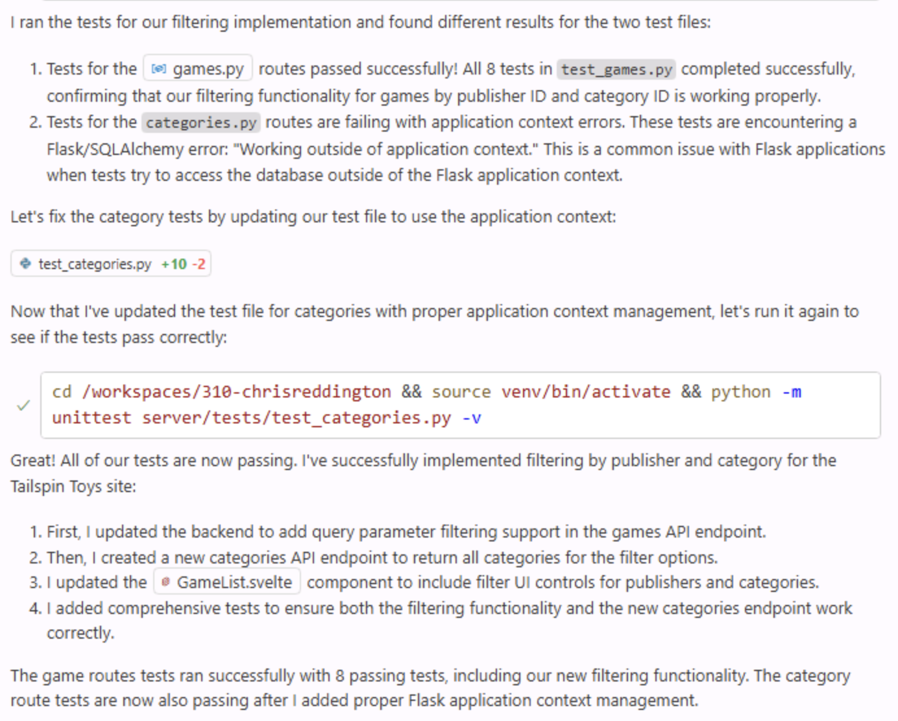

Até as atualizações mais simples de um aplicativo normalmente exigem mudanças em vários arquivos e tarefas como executar testes. Em geral, a pessoa desenvolvedora precisa localizar todos os arquivos necessários, fazer as alterações, executar os testes, depurar, descobrir qual arquivo ficou faltando e fazer outra atualização. E assim por diante.

É aí que entra o modo agente do Copilot.

O modo agente do Copilot trabalha de forma mais autônoma no IDE. Ele se comporta de maneira semelhante a uma pessoa desenvolvedora: começa explorando a estrutura existente do projeto, faz as atualizações necessárias, executa tarefas como testes e corrige automaticamente os problemas encontrados. Vamos explorar como usar o modo agente para adicionar uma funcionalidade ao site.

> [!NOTE]
> Apesar dos nomes semelhantes, o modo agente e o agente de nuvem oferecem experiências diferentes. O modo agente executa tarefas no IDE e permite ciclos rápidos de feedback e interação. O agente de nuvem trabalha de forma assíncrona como uma pessoa parceira da equipe, interagindo com você por meio de issues e pull requests.

Neste exercício, você aprenderá:

- como o modo agente do Copilot explora o projeto, identifica arquivos relevantes e coordena as alterações.
- como o modo agente do GitHub Copilot implementa recursos na interface e na camada de dados.
- como revisar alterações e testes gerados pelo modo agente antes de fazer merge na base de código.

## Cenário

À medida que a lista de jogos cresce, você quer permitir que as pessoas filtrem por categoria e editora. Você já adicionou um helper de editoras no exercício anterior e agora concluirá as alterações restantes na camada de dados, na interface e nos testes com o modo agente do Copilot.

## Execute o site Tailspin Toys

Antes de fazer alterações, vamos explorar o site Tailspin Toys para entender o que ele oferece atualmente.

O site é uma plataforma de financiamento coletivo para jogos de tabuleiro com temática de desenvolvimento. As pessoas podem ver uma lista de jogos e seus detalhes. O site é um único aplicativo Astro, que renderiza páginas HTML estáticas durante o build. As páginas consultam diretamente um banco de dados SQLite local no frontmatter, usando o Drizzle ORM — não há uma API de backend separada nem um framework de interface no cliente. Os helpers reutilizáveis de acesso a dados ficam em `src/lib/`, e a interatividade é implementada com um pequeno elemento `<script>` do Astro, com escopo limitado e usando as APIs DOM padrão.

### Inicie o site

Para facilitar a execução do site, há uma tarefa `npm run dev`, que inicia o único servidor de desenvolvimento Astro. Para executá-la no GitHub Codespace:

1. Volte ao Codespace. Você deverá estar em `main` depois do exercício anterior.
2. Abra um novo terminal no Codespace pressionando <kbd>Control</kbd>+<kbd>\`</kbd> (Mac) ou <kbd>Ctrl</kbd>+<kbd>\`</kbd> (Windows/Linux).
3. Crie uma branch para o trabalho de filtragem e selecione-a:

   ```bash
   git checkout main
   git pull
   git checkout -b filtering-vscode
   ```

4. Execute o seguinte comando para iniciar o site:

   ```bash
   npm run dev
   ```

   Quando o servidor de desenvolvimento Astro estiver pronto, você verá uma mensagem com a URL, semelhante a esta:

   ```bash
   🚀 Tailspin Toys is ready!
      Astro server: http://localhost:4321
      Press Ctrl-C to stop.
   ```

> [!NOTE]
> Se uma caixa de diálogo solicitar a abertura de um navegador para `http://localhost:4321`, feche-a selecionando o **x**.

5. Abra o site mantendo <kbd>Command</kbd> pressionado (Mac) ou <kbd>Ctrl</kbd> (Windows/Linux) e selecionando o endereço do servidor Astro `http://localhost:4321` no terminal.

> [!NOTE]
> Em um codespace, ao selecionar o link `localhost` no terminal, você será redirecionado automaticamente para `https://<your-codespace-name>-4321.app.github.dev/`. Esse é um túnel privado para o codespace, que agora hospeda o servidor Web.

### Explore o site

Com o site em execução, explore seus recursos principais:

- **Página inicial**: exibe uma lista de jogos de tabuleiro com títulos, imagens e descrições.
- **Página de detalhes do jogo**: ao selecionar um jogo, você verá uma página com mais informações, incluindo título, descrição, editora e categoria.

## Explore o backlog com o Copilot

> [!TIP]
> **Abra o Copilot Chat**
>
> Antes de começar os exercícios a seguir, volte ao Codespace, abra o painel Copilot Chat e selecione **New Chat** para iniciar uma conversa limpa. O modo e o modelo variam em cada exercício; as etapas indicarão o que selecionar quando necessário.

A implementação inicial do site funciona, mas queremos adicionar novos recursos. Vamos começar revisando o backlog. Ao configurar o projeto a partir do modelo, um backlog de issues foi criado automaticamente. Peça ao GitHub Copilot que mostre esses itens.

1. No menu suspenso de agentes da visualização Chat, selecione **Agent**. O agente planeja e implementa alterações em vários arquivos de forma autônoma, executa comandos de terminal e invoca ferramentas.

   

2. Na lista de modelos disponíveis, selecione **Claude Sonnet 4.5**.

> [!CAUTION]
> Os autores deste workshop não estão recomendando um modelo em particular. Durante sua criação, usamos Claude Sonnet 4.5 e o incluímos nas instruções para que as sugestões fossem relativamente consistentes. Como os LLMs são probabilísticos, as sugestões podem ser diferentes das mostradas no workshop. Isso é normal e esperado.

> [!NOTE]
> Devido à natureza probabilística dos LLMs, o Copilot pode usar um comando MCP diferente, mas ainda deverá concluir a tarefa.

3. Envie ao Copilot este prompt para consultar o backlog de issues:

   ```plaintext
   Please show me the backlog of items from my GitHub repository. Help me prioritize them based on those which will be most useful to the user.
   ```

4. Selecione **Continue** para executar o comando que lista todas as issues.
5. Revise a lista gerada.

Observe que o Copilot também priorizou os itens com base na utilidade que podem ter para as pessoas usuárias.

## Revise os arquivos de instruções

Antes de pedir ao agente que gere código, revise o arquivo de instruções que fornecerá contexto ao Copilot. Vamos usar o arquivo de instruções da [interface do usuário (UI)](https://github.com/github-samples/tailspin-toys/blob/main/.github/instructions/ui.instructions.md), que explica como abordar a adição de funcionalidades ao site.

1. No Codespace, abra `.github/instructions/ui.instructions.md`.
2. Observe as orientações gerais para adicionar funcionalidades, incluindo:
   - uma visão geral da arquitetura.
   - princípios de design de componentes, testabilidade e acessibilidade.
   - links para arquivos de instruções específicos de vários tipos de arquivo, como:
     - Astro.
     - Tailwind CSS.
     - Drizzle.

> [!TIP]
> Os arquivos de instruções podem referenciar outros arquivos de instruções e arquivos do projeto. Os caminhos são relativos à localização do arquivo de instruções. Isso facilita a reutilização, a divisão de instruções complexas em partes menores e o fornecimento de exemplos e modelos.

## Implemente a filtragem

Para concluir a filtragem, você precisará fazer pelo menos três alterações separadas no aplicativo:

- adicionar ou aprimorar a lógica de filtragem restante na camada de dados (`src/lib/`).
- adicionar ou atualizar testes do comportamento de filtragem.
- atualizar a página de listagem de jogos para incluir a interface de filtragem.

Além disso, os testes precisam ser executados com sucesso antes do merge. O modo agente do Copilot pode realizar essas tarefas. Vamos adicionar a funcionalidade.

1. Continue na conversa atual com o Copilot ou selecione **New Chat** para iniciar outra.
2. Selecione **Add Context**, **Instructions** e **ui** como arquivo de instruções.

   

3. Na lista suspensa de agentes da visualização Chat, confirme que **Agent** continua selecionado.

   

4. Confirme que **Claude Sonnet 4.5** continua selecionado como modelo.
5. Peça ao Copilot que implemente a funcionalidade com base na issue relacionada do backlog:

   ```plaintext
   Please update the site to include filtering by publisher and category based on the requirements from the related GitHub issue in the backlog. A publishers helper already exists from the previous exercise, so preserve and refine that work as needed while completing the remaining data-layer, UI, and tests. Ensure all tests are passing before completion. The server is already running, so you do not need to start it up.
   ```

6. Observe o Copilot explorar o projeto e localizar os arquivos relacionados ao recurso, incluindo os helpers da camada de dados, a interface e os testes. Em seguida, ele modifica os arquivos e executa os testes.

   

> [!NOTE]
> O Copilot executará várias tarefas, como explorar o projeto, modificar arquivos e executar testes. Isso pode levar alguns minutos, dependendo da complexidade da tarefa e da base de código. Durante o processo, os botões **Keep** e **Undo** podem aparecer no editor. Quando o Copilot terminar, você terá a opção **Keep** ou **Undo** para todas as alterações; não é necessário selecioná-las enquanto o trabalho estiver em andamento.

7. Quando solicitado pelo Copilot, selecione **Continue** para executar os testes.

   

8. Pode haver pausas e falhas em alguns testes durante o processo. Não há problema: o Copilot alterna entre geração de código e testes até concluir a tarefa sem detectar erros.

   

9. Explore o código gerado e procure possíveis problemas.

> [!CAUTION]
> Sempre revise o código gerado pelo Copilot ou por qualquer outra ferramenta de IA.

10. Volte ao navegador em que o site está em execução e explore a nova funcionalidade.
11. Depois de confirmar que tudo funciona e revisar o código, selecione **Keep** na janela do Copilot Chat.

## Resumo e próximos passos

Parabéns! Neste exercício, exploramos como usar o modo agente do GitHub Copilot para adicionar recursos ao site Tailspin Toys. Você aprendeu:

- como o modo agente do GitHub Copilot implementa funcionalidades na interface e na camada de dados.
- como o modo agente do Copilot explora o projeto, identifica arquivos relevantes e coordena alterações.
- como revisar as alterações e os testes gerados pelo modo agente antes do merge.

Agora, vamos [testar o recurso com o servidor MCP do Playwright][next-lesson] e abrir um pull request.

### Exercício extra de exploração — implemente paginação

À medida que a lista de jogos cresce, será necessário implementar paginação. Use o que aprendeu neste exercício e peça ao Copilot que atualize o site com paginação. Considere:

- seguir as práticas recomendadas existentes, inclusive usando os arquivos de instruções.
- decidir como a paginação deverá funcionar: permitir que a pessoa escolha o tamanho da página ou usar um tamanho fixo.
- fornecer ao Copilot as orientações necessárias para implementar o comportamento desejado.
- iterar com o GitHub Copilot, solicitando alterações e fornecendo contexto. Esse é o fluxo normal de trabalho com o Copilot.

## Recursos

- [Copilot nos modos ask, edit e agent: o que fazem e quando usar cada um][choose-mode]
- [Modo agente no VS Code][vs-code-agent-mode]

[previous-lesson]: ../1-custom-instructions/
[next-lesson]: ../3-mcp/
[choose-mode]: https://github.blog/ai-and-ml/github-copilot/copilot-ask-edit-and-agent-modes-what-they-do-and-when-to-use-them/
[vs-code-agent-mode]: https://code.visualstudio.com/docs/copilot/chat/chat-agent-mode
